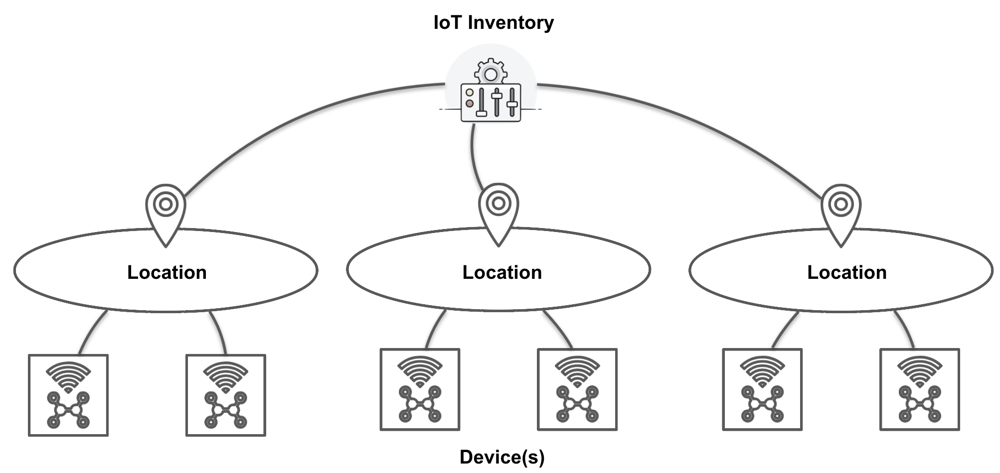
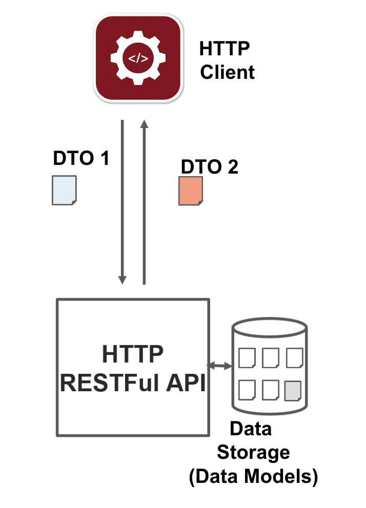
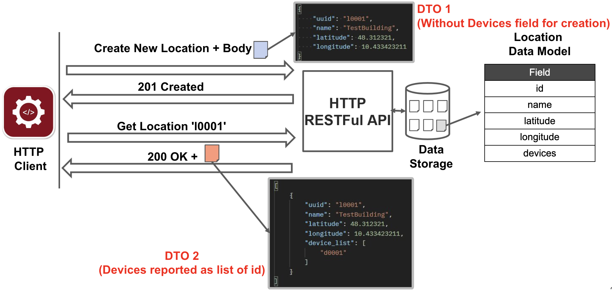

# Python - IoT Inventory - Demo RESTful HTTP API

This project shows a demo implementation of a simple IoT device and location inventory through 
an HTTP RESTful API.

The structure of the playground is the following:

- [Libraries, Frameworks, and Dependencies](#libraries-frameworks-and-dependencies)
- [Design Walkthrough: from Data Modeling to the REST API](#design-walkthrough-from-data-modeling-to-the-rest-api)
  - [Step 1 - Data Modeling (Model Classes)](#step-1---data-modeling-model-classes)
  - [Step 2 - REST Resources](#step-2---rest-resources)
  - [Step 3 - Data Models vs Data Transfer Objects (DTOs)](#step-3---data-models-vs-data-transfer-objects-dtos)
  - [Step 4 - Mapping and Decoupling: Model, Resource and DTO](#step-4---mapping-and-decoupling-model-resource-and-dto)
  - [Step 5 - Encapsulating the Storage: the DataManager Interface](#step-5---encapsulating-the-storage-the-datamanager-interface)
- [Data Manager & Persistence](#data-manager--persistence)
- [Project Structure](#project-structure)
- [Running the Project](#running-the-project)
- [Postman Collection](#postman-collection)

## Libraries, Frameworks, and Dependencies

The implementation is based on the following Python Frameworks 

- Flask: https://flask.palletsprojects.com/en/2.0.x/
- Flask RESTful: https://flask-restful.readthedocs.io/en/latest/index.html

APIs are exposed through a configurable port (7070) and accessible locally at: http://127.0.0.1:7070/api/iot/

The project is managed with [uv](https://docs.astral.sh/uv/). Dependencies are declared in `pyproject.toml`,
locked in `uv.lock`, and the Python version (3.12) is pinned in `.python-version`.

- Server dependencies: `flask`, `flask-restful`
- Client dependencies (dependency group `client`, installed by default): `requests`

Install uv (if needed) following the [official instructions](https://docs.astral.sh/uv/getting-started/installation/), e.g.:

```bash
curl -LsSf https://astral.sh/uv/install.sh | sh
```

Then, from the project root, create the virtual environment (`.venv`) and install all the dependencies with:

```bash
uv sync
```

uv automatically downloads the required Python version if it is not available on your machine.

In PyCharm, you can select the existing `.venv` interpreter or add a new "uv" interpreter from the interpreter settings.

### Using pip (alternative)

The `requirements.txt` file is **generated** from `uv.lock` and is kept only for pip-based workflows:

```bash
pip install -r requirements.txt
```

Do not edit it manually. After changing the dependencies, regenerate it with:

```bash
uv export --no-hashes --no-dev --group client -o requirements.txt
```

## Design Walkthrough: from Data Modeling to the REST API

This section describes the design path followed to build the API, from the identification of the
data to the HTTP interface exposed to the clients. The path has five steps:

1. **Data Modeling**: identify the entities of the application domain and describe them with Model classes.
2. **REST Resources**: decide which resources are exposed, how they are addressed (URIs) and which HTTP methods they support.
3. **Data Models vs DTOs**: define the representations of the resources exchanged with the clients, separating them from the internal models.
4. **Mapping and Decoupling**: connect Models, Resources and DTOs so that each layer can evolve independently.
5. **Encapsulating the Storage**: hide the internal storage behind the methods of the `DataManager`, used by the Resources both to read and to write the data.

### Application Scenario

The demo application is an **IoT Inventory**: it keeps track of a set of **Locations** (e.g., buildings, parking areas)
and of the **Devices** deployed in each of them. A Location can contain multiple Devices, while each Device belongs to exactly one Location.



### Step 1 - Data Modeling (Model Classes)

The first step is independent of HTTP: we identify the **entities** of the domain, their **fields** and the
**relationships** among them. The result is a set of **Data Models**, i.e., the classes used internally by the
application to represent, store and manipulate the data.

**Location** - `LocationModel` in `src/iot_inventory/model/location_model.py`

| Field               | Type         | Description                                                     |
|---------------------|--------------|-----------------------------------------------------------------|
| `uuid`              | string       | Unique identifier of the location (e.g., `l0001`)               |
| `name`              | string       | Human-readable name of the location                             |
| `latitude`          | float        | Latitude of the location                                        |
| `longitude`         | float        | Longitude of the location                                       |
| `device_dictionary` | dict         | Devices of the location, indexed by device `uuid` (the `devices` field in the slides) |

**Device** - `DeviceModel` in `src/iot_inventory/model/device_model.py`

| Field              | Type   | Description                                                                                  |
|--------------------|--------|----------------------------------------------------------------------------------------------|
| `uuid`             | string | Unique identifier of the device (e.g., `d0001`)                                              |
| `name`             | string | Human-readable name of the device                                                            |
| `locationId`       | string | Identifier of the Location the device belongs to                                             |
| `type`             | string | Device category: `device.default`, `device.mobile`, `device.sensor`, `device.actuator`       |
| `manufacturer`     | string | Manufacturer of the device                                                                   |
| `software_version` | string | Software/firmware version running on the device                                              |
| `latitude`         | float  | Latitude of the device                                                                       |
| `longitude`        | float  | Longitude of the device                                                                      |

The relationship between the two entities is a **containment**: each `LocationModel` owns a dictionary of `DeviceModel`
objects, and each device keeps a reference to its location through `locationId`.

```python
class LocationModel:
    """ Location Model describing the location properties """
    def __init__(self, uuid, name, latitude, longitude):
        self.uuid = uuid
        self.name = name
        self.latitude = latitude
        self.longitude = longitude
        self.device_dictionary = {}
```

The Models are stored and managed by the `DataManager` (`src/iot_inventory/persistence/data_manager.py`), which
represents the (in-memory) storage layer. The `DataManager` accepts **only Model instances** (it checks them with
`isinstance` and raises a `TypeError` otherwise): it knows nothing about HTTP, JSON or the format of requests and responses.
Its internal storage is private and it is accessed only through its methods, both for writing and for reading.
Its structure and interface are described in [Data Manager & Persistence](#data-manager--persistence).

### Step 2 - REST Resources

Once the data are modeled, we identify the **REST Resources** exposed by the API. Each resource:

- is **addressable** through a URI;
- is manipulated through the **uniform interface** of the HTTP methods, each mapped to a CRUD operation;
- reports the outcome of each operation with a **status code** that has a specific meaning.

For each entity we have two kinds of resources: a **collection resource** (the list of locations, the list of devices of a location)
and an **item resource** (a single location, a single device). Since a Device belongs to a Location, device URIs are
**nested** under the URI of their Location. All the URIs share the base path `/api/iot/inventory`.

- **/location**
  - _GET_: Returns the list of available locations
  - _POST_: Handles the creation of a new location

- **/location/<location_id>**
  - _GET_: Returns the target location with the specified `location_id`
  - _PUT_: Updates the target location with the specified `location_id`
  - _DELETE_: Deletes the target location with the specified `location_id`

- **/location/<location_id>/device**
  - _GET_: Returns the list of devices for the specified `location_id` (optionally filtered by type with the query parameter `?type=<device_type>`, e.g., `?type=device.sensor`)
  - _POST_: Creates a new device for the specified `location_id`

- **/location/<location_id>/device/<device_id>**
  - _GET_: Returns the target device with the specified `device_id` associated with the specified `location_id`
  - _PUT_: Updates the target device with the specified `device_id` associated with the specified `location_id`
  - _DELETE_: Deletes the target device with the specified `device_id` associated with the specified `location_id`

A string like `<location_id>` or `<device_id>` is a placeholder for the actual location or device identifier.
In the current implementation device's data (e.g., temperature values or actuator status) are not handled and they are out of the scope of the demo inventory.

Each resource is implemented by a Flask-RESTful `Resource` class (in `src/iot_inventory/resources/`), whose methods
(`get`, `post`, `put`, `delete`) correspond to the supported HTTP methods:

| URI (after `/api/iot/inventory`)              | Resource Class      | Method | Success                                | Errors                     |
|-----------------------------------------------|---------------------|--------|----------------------------------------|----------------------------|
| `/location`                                   | `LocationsResource` | GET    | `200 OK` + list of locations           |                            |
|                                               |                     | POST   | `201 Created` + `Location` header      | `400`, `409`, `500`        |
| `/location/<location_id>`                     | `LocationResource`  | GET    | `200 OK` + location                    | `404`                      |
|                                               |                     | PUT    | `204 No Content`                       | `400`, `404`, `500`        |
|                                               |                     | DELETE | `204 No Content`                       | `404`, `500`               |
| `/location/<location_id>/device`              | `DevicesResource`   | GET    | `200 OK` + list of devices             | `404`                      |
|                                               |                     | POST   | `201 Created` + `Location` header      | `400`, `404`, `409`, `500` |
| `/location/<location_id>/device/<device_id>`  | `DeviceResource`    | GET    | `200 OK` + device                      | `404`                      |
|                                               |                     | PUT    | `204 No Content`                       | `400`, `404`, `500`        |
|                                               |                     | DELETE | `204 No Content`                       | `404`, `500`               |

The choice of methods and status codes follows the semantics of the HTTP verbs:

- **GET** (safe and idempotent) reads a resource; the request body is empty.
- **POST** (not safe, not idempotent) creates a new resource; the server answers with `201 Created` and the URI of the new resource in the `Location` header, to be used for the subsequent operations.
- **PUT** (not safe, idempotent) updates the resource identified by the URI.
- **DELETE** (not safe, idempotent) removes the resource identified by the URI.
- `4xx` codes report client errors (e.g., `404 Not Found`, `409 Conflict` for an already existing `uuid`), while `5xx` codes report server errors.

Resources are registered in `create_server_app()` (`src/iot_inventory/api_server.py`). The `DataManager` is
**injected** into every resource through `resource_class_kwargs`, so all the resources share the same storage without
creating it themselves (see [Data Manager & Persistence](#data-manager--persistence)):

```python
api.add_resource(LocationsResource, ENDPOINT_PREFIX + '/location',
                 resource_class_kwargs={'data_manager': data_manager},
                 endpoint="locations",
                 methods=['GET', 'POST'])
```

#### Resource Identifiers and the `Location` Header

The identifier of a resource (the `<location_id>` or `<device_id>` part of its URI) is **created and managed internally
by the server**. It does not have to match the `uuid` sent by the client in the request body or, more in general, any
information contained in the representation of the resource sent by the client. The two values may coincide, but this is
only an **implementation choice** of the server: it could, for example, generate the identifier itself (a counter, a random
UUID, a database key) and ignore or store separately the value received from the client.

In this demo, the server reuses the `uuid` received in the creation request as the resource identifier
(`request.url + "/" + new_location_model.uuid`), but clients **must not rely on this assumption**. After the creation of a
resource (`POST` → `201 Created`), the client has to read the **`Location` header** of the response to know the URI, and
therefore the identifier, of the resource that has been created, and use it for all the following requests (`GET`, `PUT`, `DELETE`):

```
POST /api/iot/inventory/location HTTP/1.1
Content-Type: application/json

{"uuid": "l101", "name": "PythonTestBuilding", "latitude": 48.412321, "longitude": 10.533423211}

HTTP/1.1 201 CREATED
Location: http://127.0.0.1:7070/api/iot/inventory/location/l101
```

The client `client/create_and_get_location.py` shows this pattern: it creates a location and then reads it using the
URI received in the `Location` header.

### Step 3 - Data Models vs Data Transfer Objects (DTOs)

#### Resources and Representations in REST

REST stands for **RE**presentational **S**tate **T**ransfer, and the name already describes how the data are exchanged:

- a client never handles a resource directly: it only handles **representations** of the resource's state (in this project, JSON documents);
- client and server **transfer these representations** through the uniform interface (HTTP methods on URIs): the client sends a representation to create or update a resource (POST, PUT), and the server returns a representation when the resource is read (GET);
- messages are **self-descriptive**: the format of the representation is declared in the headers (`Content-Type: application/json`), the outcome by the status code, and the link to a new resource by the `Location` header;
- the **same resource can have different representations** depending on the interaction (what the client must send to create a location is different from what it receives when it reads it);
- the server is free to keep the resource in **any internal form**: the representation is a contract with the clients, not a copy of the server's internal data structures.

Translated into code, this leads to two distinct kinds of classes:

- the **Data Model** is the **internal state** of the resource;
- the **Data Transfer Object (DTO)** is the **code-level form of a representation** of the resource, i.e., what is actually transferred over HTTP.

#### Data Models and DTOs

- **Data Models** represent the structure and the attributes of the entities within the application. They define how the
  data are organized, which properties they hold and how they relate to each other. They are used **internally** to manage and manipulate the data.
- **Data Transfer Objects (DTOs)** are objects used specifically to **transfer data** between different parts of a
  system, typically through remote communication such as an HTTP RESTful API. A DTO contains a **subset** (or a
  reshaping) of the data of a Model, designed for a specific request or response. DTOs reduce the unnecessary data
  sent over the network and keep a **clear separation** between the internal data structures and the data exposed by the API.

As a general rule: **a Resource typically has one Data Model and multiple DTOs**, one for each kind of request and response.



|                   | Data Model                                    | DTO                                                       |
|-------------------|-----------------------------------------------|-----------------------------------------------------------|
| Purpose           | Represent the internal state of an entity     | Represent the data exchanged in a request or response     |
| Where it lives    | Business logic and storage (`DataManager`)    | Boundary of the API (`Resource` classes)                  |
| Who sees it       | Only the server application                   | The clients (serialized as JSON)                          |
| How many          | One per entity                                | Many per entity (creation, update, response, ...)        |
| When it changes   | When the internal design changes              | When the API contract changes                             |

The DTOs of the project are in `src/iot_inventory/dto/`:

| DTO                       | Used by                                              | Content                                                                                         |
|---------------------------|------------------------------------------------------|-------------------------------------------------------------------------------------------------|
| `LocationCreationRequest` | `POST /location`                                     | `uuid`, `name`, `latitude`, `longitude` (no devices: a new location is empty)                   |
| `LocationUpdateRequest`   | `PUT /location/<location_id>`                        | `uuid`, `name`, `latitude`, `longitude`                                                         |
| `LocationEntityResponse`  | `GET /location`, `GET /location/<location_id>`       | `uuid`, `name`, `latitude`, `longitude`, `device_list` (only the **ids** of the devices)        |
| `DeviceCreationRequest`   | `POST /location/<location_id>/device`                | `uuid`, `name`, `device_type`, `manufacturer`, `software_version`, `latitude`, `longitude` (no `locationId`: it is taken from the URI) |
| `DeviceUpdateRequest`     | `PUT /location/<location_id>/device/<device_id>`     | Same fields of the creation request                                                            |
| `DeviceEntityResponse`    | `GET /location/<location_id>/device`, `GET /location/<location_id>/device/<device_id>` | `uuid`, `name`, `locationId`, `type`, `manufacturer`, `software_version`, `latitude`, `longitude` |

> **Note:** the difference between `device_type` and `type` is **intentional**. In the request DTOs
> (`DeviceCreationRequest`, `DeviceUpdateRequest`) the device category is sent with the `device_type` key, while the
> response DTO (`DeviceEntityResponse`) reports it with the `type` key, and the `DeviceModel` stores it in its own `type`
> attribute. The client always works with **representations** of the resource, never with its internal state: the
> representation sent to create or update a device and the one received when reading it are two different documents,
> each defined by its own DTO, and neither of them has to mirror the internal Model. It is the server, through the mapping
> between DTOs and Model, that translates one representation into the other.

The Location resource shows the difference well. The client creates a location sending this representation
(`LocationCreationRequest`), without any device:

```json
{
  "uuid": "l101",
  "name": "PythonTestBuilding",
  "latitude": 48.412321,
  "longitude": 10.533423211
}
```

When the location is read, the client receives a different representation (`LocationEntityResponse`), where the internal
`device_dictionary` of the model (with the complete `DeviceModel` objects) is replaced by the list of the device ids:

```json
{
  "uuid": "l0001",
  "name": "TestBuilding",
  "latitude": 48.312321,
  "longitude": 10.433423211,
  "device_list": ["d0001"]
}
```

The details of each device remain available through its own resource (`/location/l0001/device/d0001`).



### Step 4 - Mapping and Decoupling: Model, Resource and DTO

The three building blocks are organized in layers, and each one has a single responsibility:

```
HTTP Client  <-- JSON -->  DTO  <-->  Resource  <-->  Model  <-->  DataManager
             (representation)      (mapping)        (internal state / storage)
```

- the **DTO** describes the representation transferred over HTTP;
- the **Model** describes the internal state, stored by the `DataManager` (see [Data Manager & Persistence](#data-manager--persistence));
- the **Resource** connects the two worlds: it receives the HTTP request, builds the request DTO, triggers the **mapping**
  between DTOs and Models, invokes the `DataManager` and builds the HTTP response with the proper status code.

The mapping code is defined once, in dedicated static methods, and reused by all the resources:

| Direction      | Method                                                     | Defined in                                   |
|----------------|------------------------------------------------------------|----------------------------------------------|
| DTO → Model    | `LocationModel.from_creation_dto(dto)`                     | `model/location_model.py`                    |
| DTO → Model    | `LocationModel.from_update_dto(dto)`                       | `model/location_model.py`                    |
| DTO → Model    | `DeviceModel.from_creation_dto(location_id, dto)`          | `model/device_model.py`                      |
| DTO → Model    | `DeviceModel.from_update_dto(location_id, dto)`            | `model/device_model.py`                      |
| Model → DTO    | `LocationEntityResponse.from_model(location)`              | `dto/location_entity_response.py`            |
| Model → DTO    | `DeviceEntityResponse.from_model(device)`                  | `dto/device_entity_response.py`              |

This mapping is exactly the boundary between the **representation** (what is transferred) and the **state** (what is
stored) described by the REST principles. Serialization and deserialization convert DTOs to and from their JSON
representation on the wire.

#### Inbound Mapping: DTO to Model (`POST /location`)

From `LocationsResource.post()` in `src/iot_inventory/resources/locations_resource.py`:

```python
# 1. Deserialize the JSON body of the request
json_data = request.get_json(force=True)

# 2. Build the DTO from the received representation
location_creation_request = LocationCreationRequest(**json_data)

# 3. Map the DTO to the internal Model
new_location_model = LocationModel.from_creation_dto(location_creation_request)

# 4. Store the Model and answer with 201 + the URI of the new resource
self.data_manager.add_location(new_location_model)
return Response(status=201, headers={"Location": request.url+"/"+new_location_model.uuid})
```

The same pattern is used for devices in `DevicesResource.post()`: note that the `locationId` of the `DeviceModel` is not
part of the `DeviceCreationRequest`, but is taken from the **URI** of the resource (`/location/<location_id>/device`) and
passed to `DeviceModel.from_creation_dto(location_id, device_creation_request)`.
The DTO contains only what the client has to send; the rest of the Model is filled in by the server.

The same applies to the update of a location (`LocationResource.put()`): the `LocationUpdateRequest` does not contain the
devices, so after the mapping the server keeps the devices of the current location (retrieved with
`self.data_manager.get_location(location_id)` at the beginning of the method). The server also checks that the
`uuid` in the body matches the `location_id` of the URI, answering with `400 Bad Request` otherwise:

```python
# Check if the UUID in the body matches the one in the path
if location_update_request.uuid != location_id:
    return {'error': "UUID mismatch between body and resource"}, 400
else:
    # Map the Update DTO to a new Location Model with the updated data
    updated_location_model = LocationModel.from_update_dto(location_update_request)

    # The update representation does not contain the devices: keep the ones of the current location
    updated_location_model.device_dictionary = current_location_model.device_dictionary
```

If the request body is not valid, the error is reported to the client as a `400 Bad Request`:

- an invalid JSON makes `request.get_json()` raise a `BadRequest` exception;
- a JSON with missing or unknown fields makes the DTO constructor (`LocationCreationRequest(**json_data)`) raise a `TypeError`.

Both cases are client errors, handled before any Model is created or stored:

```python
except BadRequest:
    # Raised by get_json() when the body is not a valid JSON
    return {'error': "Invalid JSON ! Check the request"}, 400
except TypeError as e:
    # Raised by the DTO constructor when the body has missing or unknown fields
    return {'error': "Invalid request body ! Reason: " + str(e)}, 400
except Exception as e:
    return {'error': "Generic Internal Server Error ! Reason: " + str(e)}, 500
```

#### Outbound Mapping: Model to DTO (`GET /location/<location_id>`)

From `LocationResource.get()` in `src/iot_inventory/resources/location_resource.py`:

```python
# 1. Retrieve the internal Model (None if it does not exist)
location = self.data_manager.get_location(location_id)

if location is not None:
    # 2. Map the Model to the response DTO
    location_entity_response = LocationEntityResponse.from_model(location)

    # 3. Return the representation (serialized to JSON by Flask-RESTful) with 200 OK
    return location_entity_response.__dict__, 200
else:
    return {'error': "Location Not Found !"}, 404
```

where `LocationEntityResponse.from_model()` (`src/iot_inventory/dto/location_entity_response.py`) reshapes the internal
data, reporting the dictionary of `DeviceModel` objects as the list of the device ids:

```python
@staticmethod
def from_model(location: LocationModel) -> "LocationEntityResponse":
    """ Static Method to create a Location Entity Response DTO from a Location Model """

    # The internal dictionary of devices is reported as the list of the device ids
    device_id_list = [device.uuid for device in location.device_dictionary.values()]

    return LocationEntityResponse(location.uuid,
                                  location.name,
                                  location.latitude,
                                  location.longitude,
                                  device_id_list)
```

The device resources follow the same approach with `DeviceEntityResponse.from_model()`, so the `DeviceModel` is never
returned directly to the clients.

#### Summary of the Mapping

| Endpoint & Method                                   | Input DTO                 | Model          | Output                                    |
|-----------------------------------------------------|---------------------------|----------------|-------------------------------------------|
| `POST /location`                                    | `LocationCreationRequest` | `LocationModel`| `201` + `Location` header                 |
| `GET /location`                                     | -                         | `LocationModel`| list of `LocationEntityResponse`          |
| `GET /location/<location_id>`                       | -                         | `LocationModel`| `LocationEntityResponse`                  |
| `PUT /location/<location_id>`                       | `LocationUpdateRequest`   | `LocationModel`| `204`                                     |
| `POST /location/<location_id>/device`               | `DeviceCreationRequest`   | `DeviceModel`  | `201` + `Location` header                 |
| `GET /location/<location_id>/device`                | -                         | `DeviceModel`  | list of `DeviceEntityResponse`            |
| `GET /location/<location_id>/device/<device_id>`    | -                         | `DeviceModel`  | `DeviceEntityResponse`                    |
| `PUT /location/<location_id>/device/<device_id>`    | `DeviceUpdateRequest`     | `DeviceModel`  | `204`                                     |

#### Why Decoupling Matters

- The **internal Model can change** (e.g., a different storage structure, new internal fields) **without breaking the API contract** with the clients.
- **Internal details are not exposed**: clients receive only the data they need (e.g., `device_list` instead of the whole `device_dictionary`).
- Requests are **checked at the boundary**: a DTO defines exactly which fields a request must contain, before any Model is created or stored.
- **Different representations** (or different API versions) can be offered on top of the same Model.

#### Type Hints

The code uses Python **type hints** (Python >= 3.10 syntax, e.g., `list[str]`, `DataManager | None`) on Models, DTOs,
the `DataManager` and the Resource methods. They make the role of each layer explicit (e.g., the `DataManager` accepts
only `LocationModel` and `DeviceModel` objects, the mapping methods go from a DTO to a Model and vice versa) and allow
IDEs and static type checkers to detect errors before running the code:

```bash
uv run --with mypy mypy src/iot_inventory --ignore-missing-imports
```

### Step 5 - Encapsulating the Storage: the DataManager Interface

The `DataManager` stores the locations in a dictionary indexed by `uuid` (its role and structure are summarized in
[Data Manager & Persistence](#data-manager--persistence)). This dictionary is an **implementation detail**:
the Resources must not know how the data are stored, but only **what** they can ask to the storage layer. For this reason
the dictionary is **private** and the `DataManager` offers methods both to **write** and to **read** the data.

#### A Private Storage

In Python there is no `private` keyword (as in Java or C#). The convention is to prefix the name of an attribute with an
**underscore** (`_`): it tells the other developers (and the IDEs/linters) that the attribute is internal and must not be
used outside the class:

```python
def __init__(self) -> None:
    # The leading underscore marks the attribute as private: it must be accessed only through the methods below
    self._location_dictionary: dict[str, LocationModel] = {}
```

If the Resources accessed the dictionary directly (e.g., `self.data_manager.location_dictionary[location_id]`):

- the internal structure would become part of the "contract" between the layers: replacing the dictionary with a database,
  a file or a different structure would require changing **every** Resource;
- any piece of code could add, replace or delete items **bypassing the checks** of the `DataManager`
  (e.g., the `isinstance` check of `add_location()`), leaving the storage in an inconsistent state.

#### Read Methods

| Method                                                    | Returns                     | When the item does not exist                 |
|-----------------------------------------------------------|-----------------------------|----------------------------------------------|
| `location_exists(location_id)`                            | `bool`                      | `False`                                      |
| `get_location(location_id)`                               | `LocationModel \| None`     | `None`                                       |
| `get_location_list()`                                     | `list[LocationModel]`       | -                                            |
| `device_exists(location_id, device_id)`                   | `bool`                      | `False` (also if the location does not exist)|
| `get_device(location_id, device_id)`                      | `DeviceModel \| None`       | `None` (also if the location does not exist) |
| `get_device_list(location_id, device_type=None)`          | `list[DeviceModel]`         | raises `IndexError` for an unknown location  |

The `*_exists` methods are used when the Resource has only to check if a resource is there (e.g., before a `DELETE`
or to detect a `409 Conflict` in a `POST`), while the `get_*` methods return the Model to work with. Returning `None`
for a missing item makes the Resource code simple and maps naturally to the `404 Not Found` status code:

```python
location = self.data_manager.get_location(location_id)

if location is not None:
    return LocationEntityResponse.from_model(location).__dict__, 200
else:
    return {'error': "Location Not Found !"}, 404
```

`get_device_list()` instead raises an `IndexError` for an unknown location, as the other device methods
(`add_device()`, `update_device()`, `remove_device()`) already do: an empty list would be ambiguous, since it would mean
both "the location has no devices" and "the location does not exist". The Resources check `location_exists()` first.

#### Why the Lists are Returned as Copies

`get_location_list()` does **not** return the internal collection, but a **new list** built from it:

```python
def get_location_list(self) -> list[LocationModel]:
    # Return a new list: adding or removing items from it does not change the internal storage
    return list(self._location_dictionary.values())
```

In Python variables are **references** to objects: assigning or returning an object does not copy it, it gives another
name to the **same** object (this is called **aliasing**). If a method returned the internal collection itself, the caller
could change the storage without passing through the `DataManager`:

```python
# Hypothetical method returning the internal dictionary (what we want to avoid)
locations = data_manager.get_location_dictionary()
locations.clear()                  # All the locations are deleted from the storage !
locations["x"] = "not a location"  # An invalid item is stored, bypassing the isinstance check !
```

With a copy, the caller receives its own list and can sort it, filter it or empty it without any side effect on the
storage:

```python
location_list = data_manager.get_location_list()
location_list.clear()                        # Only the local copy is emptied
print(len(data_manager.get_location_list())) # The storage still contains all the locations
```

Returning a list (instead of the `dict_values` view returned by `.values()`) has two further advantages: the view is
**live** (it changes when the dictionary changes, and iterating over it while the storage is modified raises a
`RuntimeError`), and a `list` is a simple, well-known type that does not reveal that a dictionary is used internally.
`get_device_list()` follows the same idea: the list comprehension that applies the filter always builds a new list.

Note that this is a **shallow copy**: the list is new, but the `LocationModel` and `DeviceModel` objects inside it are the
**same objects** stored in the `DataManager`. Changing an attribute of one of them (e.g., `location.name = "..."`) would
change the stored data. The copy protects the **structure** of the storage (which items it contains), not the state of the
single items. A complete protection would require a deep copy (`copy.deepcopy()`) or immutable Models, at the cost of more
memory and computation. In this project the objects are never exposed to the clients: the Resources map them to DTOs
before answering, and they change the stored data only through `update_location()` and `update_device()`.

#### Filtering the Device List

The `GET /location/<location_id>/device` endpoint supports an optional **query parameter** `type` to filter the devices
by their type. Query parameters do not identify a new resource: they refine the representation of the same collection.

```
GET /api/iot/inventory/location/l0001/device                    -> all the devices of the location
GET /api/iot/inventory/location/l0001/device?type=device.sensor -> only the sensors of the location
```

The query parameter is named simply `type` (and not `device_type`) because it is applied to the **device collection
resource**: the URI `/location/<location_id>/device` already states that we are working with devices, so the association
between the parameter and the device is **implicit**. Repeating the name of the resource in its parameters would be
redundant (as `?device_type=` or `?device_name=`), while short names keep the URIs readable. For the same reason the
`type` field of the device representation (`DeviceEntityResponse`) is called `type`, matching the name of the parameter
used to filter it.

The Resource reads the parameter with `reqparse` and passes it to the `DataManager`, which applies the filter while
building the list (a missing parameter is `None` and means "no filter"):

```python
# DevicesResource.get()
type_filter = args.get("type")
device_model_list = self.data_manager.get_device_list(location_id, type_filter)
```

```python
# DataManager.get_device_list()
return [device for device in target_location.device_dictionary.values()
        if device_type is None or device.type == device_type]
```

Filtering in the `DataManager` instead of in the Resource keeps the logic close to the data: with a database, the same
method would become a query with a `WHERE` clause, without changing the Resource. A filter that matches no device returns
an empty list with `200 OK`, since the collection exists but it has no matching items.

## Data Manager & Persistence

The `DataManager` class (`src/iot_inventory/persistence/data_manager.py`) is the **persistence layer** of the
application: it is the **single point of access** to the stored data. Every Resource that needs to read, create, update
or delete a location or a device asks the `DataManager`, and never touches the data directly.

```
Resources  -- add_* / update_* / remove_* -->  DataManager  -->  storage (in-memory dictionary)
           <-- get_* / *_exists --------------
```

The `DataManager` works only with **Models** (`LocationModel`, `DeviceModel`): it knows nothing about HTTP, JSON, URIs or
DTOs. This separation allows to change how the data are stored without changing the way they are exposed by the API, and vice versa.

### Storage Structure

The data are kept **in memory**, in a private dictionary of locations indexed by their `uuid`. Each `LocationModel`
contains in turn the dictionary of its devices (`device_dictionary`), indexed by the device `uuid`:

```
_location_dictionary: dict[str, LocationModel]
└── "l0001" -> LocationModel(uuid="l0001", name="TestBuilding", ...)
              └── device_dictionary: dict[str, DeviceModel]
                  ├── "d0001" -> DeviceModel(uuid="d0001", type="device.default", ...)
                  └── "d0002" -> DeviceModel(uuid="d0002", type="device.sensor", ...)
```

This nested structure mirrors the **nested URIs** of the API (`/location/<location_id>/device/<device_id>`):

- a device can be reached only through its location, so every device method requires the `location_id`;
- removing a location also removes all its devices;
- dictionaries indexed by `uuid` allow to find, check or replace an item directly, without scanning a list.

Since the storage is in memory, **the data are lost when the server stops**. At startup `main()` creates an empty
`DataManager` and fills it with a demo location and a demo device through `load_demo_data()`.

### Lifecycle and Sharing

A single `DataManager` instance is created when the application starts and is **injected** into all the Resources by
`create_server_app()` (through `resource_class_kwargs`, see [Step 2](#step-2---rest-resources)), so that all of them work
on the same data. The storage is an **instance attribute**: each `DataManager` has its own independent data, so tests can
create a new, empty instance and pass it to `create_server_app(data_manager)` without affecting other tests.

### Interface

The methods of the `DataManager` are the only way to access the data:

| Entity   | Read                                                                     | Write                                                  |
|----------|--------------------------------------------------------------------------|--------------------------------------------------------|
| Location | `location_exists()`, `get_location()`, `get_location_list()`            | `add_location()`, `update_location()`, `remove_location()` |
| Device   | `device_exists()`, `get_device()`, `get_device_list()` (with type filter) | `add_device()`, `update_device()`, `remove_device()`   |

The write methods check their input before changing the storage:

- `add_*` and `update_*` accept only Model instances and raise a `TypeError` otherwise;
- the device methods raise an `IndexError` if the `location_id` does not exist.

The read methods return `None` (or `False`) for a missing item and **new lists** for the collections, so that the
callers cannot change the storage by mistake. The reasons behind these choices (private storage, copies of the lists,
filtering) are discussed in [Step 5](#step-5---encapsulating-the-storage-the-datamanager-interface).

### Replacing the Storage

Because the Resources depend only on the methods of the `DataManager` and not on the dictionary, the in-memory storage
can be replaced with a persistent one (e.g., a JSON file, SQLite or another database) by **re-implementing the same
methods** with the same signatures. For example, `get_location_list()` would run a `SELECT` query and
`get_device_list(location_id, device_type)` would add a `WHERE` clause for the filter. The Resources, the DTOs and the
Models would not change.

## Project Structure

The project follows the `src` layout: the server code is the `iot_inventory` package in `src/`,
while the clients are standalone example scripts outside the package.

```
python-http-api-playground/
├── pyproject.toml          # Project metadata, dependencies and entry points
├── uv.lock                 # Locked dependency versions (managed by uv)
├── requirements.txt        # Generated from uv.lock for pip users
├── src/iot_inventory/      # Server application package
│   ├── __main__.py         # Enables: python -m iot_inventory
│   ├── api_server.py       # create_server_app() factory and main() entry point
│   ├── dto/
│   ├── model/
│   ├── persistence/
│   └── resources/
├── client/                 # Standalone HTTP client examples (requests)
└── postman/                # Postman collection
```

- **Server Application** (`src/iot_inventory`):
  - _api_server.py_: The main entry point of the project. It contains:
    - `create_server_app()`: the Flask App Factory that creates the application and registers the API resources. Importing the module has no side effects and each call returns a new, independent app (useful for testing with `app.test_client()`).
    - `load_demo_data()`: adds a demo location and a demo device to the Data Manager.
    - `main()`: loads the demo data, creates the app and starts the server on port 7070.
- **Resources**: Contains the API resources for the locations and devices. Detailed in the following files:
  - _locations_resource.py_: Contains the LocationsResource class that handles the list of devices resource.
  - _location_resource.py_: Contains the LocationResource class that handles the device resources.
  - _devices_resource.py_: Contains the DevicesResource class that handles the list of devices resource.
  - _device_resource.py_: Contains the DeviceResource class that handles the device resources.
- **Models**: Contains the data models for the locations and devices. Detailed in the following files:
  - _location_model.py_: Contains the Location class that represents a location.
  - _device_model.py_: Contains the Device class that represents a device.
- **DTO**: Contains the Data Transfer Objects (DTOs) for the locations and devices. Detailed in the following files:
  - _device_creation_request.py_: Contains the DeviceCreationRequest class that represents the request to create a device.
  - _device_update_request.py_: Contains the DeviceUpdateRequest class that represents the request to update a device. 
  - _location_creation_request.py_: Contains the LocationCreationRequest class that represents the request to create a location. 
  - _device_entity_response.py_: Contains the DeviceEntityResponse class that represents the response of a device entity.
  - _location_entity_response.py_: Contains the LocationEntityResponse class that represents the response of a location entity. 
  - _location_update_request.py_: Contains the LocationUpdateRequest class that represents the request to update a location.
- **Persistence**: Contains the data access layer for the locations and devices. Detailed in the following file:
  - _data_manager.py_: Contains the DataManager class that handles the data access layer for the locations and devices. Its storage is private and both reading (`get_*`, `*_exists`) and writing (`add_*`, `update_*`, `remove_*`) go through its methods (see [Data Manager & Persistence](#data-manager--persistence)).
- **Clients**: Contains the client to interact with the API. Detailed in the following file:
  - _create_and_get_location.py_: Implements the client to create a location and get the list of locations through the implemented API.
  - _create_location.py_: Implements the client to create a location through the implemented API.
  - _delete_location.py_: Implements the client to delete a location through the implemented API.
  - _get_location_list.py_: Implements the client to get the list of locations through the implemented API.
  - _get_single_location.py_: Implements the client to get a single location through the implemented API.
  - _update_location.py_: Implements the client to update a location through the implemented API.

## Running the Project

The server is exposed as a command (`iot-inventory-server`) declared in the `[project.scripts]` section
of `pyproject.toml`. From the project root run:

```bash
uv run iot-inventory-server
```

Alternatively, you can run it as a module or execute the file directly:

```bash
uv run python -m iot_inventory
uv run src/iot_inventory/api_server.py
```

The server will start and expose the API resources through the configured port by default (7070).

Since the app is built through the `create_server_app()` factory, it can also be started with the Flask CLI
(note that in this case the demo data are not loaded):

```bash
uv run flask --app "iot_inventory.api_server:create_server_app()" run --port 7070
```

With the server running, you can execute any of the clients in another terminal, e.g.:

```bash
uv run client/create_location.py
uv run client/get_location_list.py
```

## Postman Collection

In the `postman` folder, you can find a Postman collection that contains the requests to interact with the implemented API.
You can import the collection into Postman and run the requests to interact with the API.
  